# 🚀 Awesome RevOps Workflow Orchestration



<div align="center">

<a href="https://github.com/ishandutta2007/Awesome-Awesome-Awesome"></a><a href="https://discord.gg/jc4xtF58Ve"></a>
[](https://github.com/ishandutta2007/Awesome-Awesome-Awesome)
[](https://opensource.org/licenses/MIT)
[](http://makeapullrequest.com)
[](https://github.com/ishandutta2007/Awesome-Sales-AI-Assistant/stargazers)
<a href="https://github.com/ishandutta2007"></a>

**Curated List of SaaS Platforms & Open-Source GitHub Repositories for Revenue Operations, Lead Routing, CRM Synchronization & Agentic GTM Engines**

*Last updated: October 2026*

</div>

---

## 📌 Executive Overview & SEO Keywords

This repository tracks top-tier **commercial RevOps workflow orchestration platforms** and **open-source projects** designed to automate revenue workflows — including inbound lead routing, lead-to-account matching, CRM data hygiene, deal scoring, pipeline monitoring, multi-system sync, and self-hosted agentic GTM operating systems.

> **Keywords**: Revenue Operations, RevOps Automation, Workflow Orchestration, Lead Routing, CRM Synchronization, Data Hygiene, CPQ Automation, Autonomous GTM Agents, Sales AI, Customer Data Platform (CDP).

---

## 📑 Table of Contents

- [🏢 SaaS & Hosted Platforms](#-saas--hosted-platforms)
- [💻 Open-Source GitHub Projects](#-open-source-github-projects)
- [🛠️ Architecture & Integration Patterns](#%EF%B8%8F-architecture--integration-patterns)
- [🤝 How to Contribute](#-how-to-contribute)
- [💖 Support & Sponsorship](#-support--sponsorship)
- [⚖️ Disclaimer & Privacy](#%EF%B8%8F-disclaimer--privacy)
- [⭐ Star History](#-star-history)

---

## 🏢 SaaS & Hosted Platforms

> 📈 **Market Intelligence Note**:  
> **Estimated Sector Market Size**: The Revenue Operations (RevOps) and Workflow Orchestration software market is estimated at **~$4.8 Billion** in 2026 and is projected to reach **$12.5 Billion by 2030** (CAGR ~21%).  
> **Market Concentration**: **Moderately Fragmented** — category leaders (lead routing, CPQ, data sync) compete alongside enterprise CRM suites, offering best-of-breed modular engines.

### 📊 Enterprise SaaS Comparison Table (Sorted by Company Size / Valuation Descending)

| 🏢 Product / Company | 📝 Description & Key Strengths | 💰 Starting Pricing | 🎁 Free Tier / Trial Limits | 📊 Company Size / Valuation |
| :--- | :--- | :--- | :--- | :--- |
| **[Salesforce Revenue Orchestration](https://www.salesforce.com/)** | 💼 **Enterprise CRM Orchestration** — Flow Builder, Process Automation, and Einstein AI for end-to-end revenue workflows. | `$25` / user / mo *(Starter Suite)* | ⏳ **14-day free trial** *(Full Starter Suite access, no credit card required)* | 🏛️ **$34.9B Revenue** <br>`($280B Market Cap)` |
| **[Chili Piper](https://www.chilipiper.com/)** | ⚡ **Inbound Lead Conversion & Scheduling** — Instantly route inbound leads to the right rep and book meetings automatically. | `$30` / user / mo `(+$150/mo platform fee)` | 🎁 **Free plan available** *(Up to 100 meetings booked/yr)* | 🚀 **$250M Valuation** <br>`($30M ARR)` |
| **[LeanData](https://www.leandata.com/)** | 🎯 **Lead-to-Account Matching & Routing** — Enterprise gold standard for lead routing, territory assignment, and revenue flow graphs. | `$39` / user / mo `(~$12,000/yr minimum)` | ⏳ **14-day interactive trial** *(Includes full sandbox routing builder)* | 🏆 **$150M Valuation** <br>`($40M ARR)` |
| **[Troops](https://www.troops.ai/)** *(by Salesforce)* | 💬 **Slack-Native Deal Workflow Automation** — Instant Slack/Teams alerts, deal updates, and automated sales approvals. | `$19` / user / mo *(Core Deal Workflow)* | ⏳ **14-day free trial** *(Includes up to 5 active deal workflow alerts)* | 🏢 **$100M Acquired** <br>`($12M ARR pre-acquisition)` |
| **[Syncari](https://syncari.com/)** | 🔄 **Revenue Data Synchronization & Deduplication** — Bi-directional multi-system data unification across CRM, ERP, and marketing engines. | `$2,995` / month *(Starter Tier)* | ⏳ **14-day free trial** *(Up to 5,000 synced records)* | 📈 **$80M Valuation** <br>`($15M ARR)` |
| **[Tonkean](https://tonkean.com/)** | 🧩 **No-Code Process Orchestration** — Custom intake, approval workflows, and task routing across CRM, Slack, and email. | `$500` / month *(Standard up to 5 builders)* | ⏳ **30-day free trial** *(Up to 3 active workflows & 5 builder seats)* | 💼 **$75M Valuation** <br>`($12M ARR)` |
| **[Openprise](https://www.openprise.com/)** | 🧹 **Data Hygiene & RevOps Automation** — Data deduplication, normalization, enrichment, and automated lead routing at scale. | `$2,500` / month *(Data Starter Package)* | ⏳ **14-day free trial** *(Includes data hygiene assessment up to 10k records)* | 🛡️ **$60M Valuation** <br>`($18M ARR)` |
| **[CaliberMind](https://calibermind.com/)** | 📊 **B2B Revenue Intelligence & Attribution** — Unifies marketing, sales, and product usage data for pipeline attribution. | `$3,000` / month *(Growth Plan)* | ⏳ **14-day interactive trial** *(Pipeline audit with sample CRM data)* | 💡 **$40M Valuation** <br>`($8M ARR)` |
| **[Full Circle Insights](https://www.fullcircleinsights.com/)** | 📈 **Salesforce-Native Funnel Analytics** — Native CRM analytics for pipeline velocity, marketing attribution, and deal tracking. | `$1,500` / month *(Response Management)* | ⏳ **14-day test drive** *(Salesforce AppExchange sandbox trial)* | 🏢 **$35M Valuation** <br>`($10M ARR)` |
| **[RevOps.io](https://revops.io/)** | 📝 **Deal Desk & CPQ Workflow Automation** | `$50` / user / mo *(CPQ Starter)* | ⏳ **14-day free trial** *(Up to 2 deal templates & 3 user seats)* | 🌟 **$25M Valuation** <br>`($5M ARR)` |

---

## 💻 Open-Source GitHub Projects

> 🌟 **Self-Hosted & Agentic Ecosystem**:  
> The open-source RevOps sector ranges from high-throughput workflow engines to terminal-native AI SDRs and 17-agent GTM operating systems.

### 🚀 Open-Source Repositories (Sorted by GitHub Star Count Descending)

1. **[n8n](https://github.com/n8n-io/n8n)**  
   [](https://github.com/n8n-io/n8n/stargazers)  
   ⚡ **Fair-code workflow automation platform** — Build complex RevOps workflows, lead enrichment pipelines, CRM synchronization, and multi-app triggers with 400+ native integrations and node-based visual editing.

2. **[Twenty CRM](https://github.com/twentyhq/twenty)**  
   [](https://github.com/twentyhq/twenty/stargazers)  
   Modern open-source CRM alternative to Salesforce — Built with GraphQL, extensible data models, deal tracking, automated triggers, and full data sovereignty for revenue teams.

3. **[Cal.com](https://github.com/calcom/cal.com)**  
   [](https://github.com/calcom/cal.com/stargazers)  
   📅 **Open-source scheduling infrastructure** — Automate meeting routing, round-robin distribution, and inbound lead booking workflows integrated with your CRM stack.

4. **[Apache Airflow](https://github.com/apache/airflow)**  
   [](https://github.com/apache/airflow/stargazers)  
   ⚙️ **Enterprise workflow management platform** — Programmatic DAG-based platform for complex revenue data ingestion, warehouse ETL pipelines, and revenue analytics orchestration.

5. **[ERPNext](https://github.com/frappe/erpnext)**  
   [](https://github.com/frappe/erpnext/stargazers)  
   💼 **Full-suite open-source ERP & CRM** — Integrates lead management, CPQ quoting, sales orders, invoicing, subscription billing, and revenue analytics in one Python/Frappe core.

6. **[Activepieces](https://github.com/activepieces/activepieces)**  
   [](https://github.com/activepieces/activepieces/stargazers)  
   🧩 **Open-source business automation & Zapier alternative** — No-code business automation and RevOps integration engine with self-hosting capabilities and custom TypeScript piece builder.

7. **[Temporal](https://github.com/temporalio/temporal)**  
   [](https://github.com/temporalio/temporal/stargazers)  
   🛡️ **Durable execution platform** — Code-first microservice orchestration engine that guarantees workflow completion for mission-critical payment, billing, and CRM operations.

8. **[Invoice Ninja](https://github.com/invoiceninja/invoiceninja)**  
   [](https://github.com/invoiceninja/invoiceninja/stargazers)  
   🧾 **Open-source invoicing & quote engine** — Automates recurring revenue billing, client proposals, payment gateways, and real-time revenue analytics.

9. **[Cadence](https://github.com/uber/cadence)**  
   [](https://github.com/uber/cadence/stargazers)  
   🏢 **Fault-tolerant workflow orchestration engine from Uber** — Apache-2.0 licensed, stateful workflows in Go and Java built for enterprise scale and zero downtime.

10. **[dagu](https://github.com/dagu-org/dagu)**  
    [](https://github.com/dagu-org/dagu/stargazers)  
    🪶 **Lightweight declarative workflow engine** — Simple alternative to Airflow and Cron using YAML DAG definitions, container execution, and web UI monitoring.

11. **[SDRbot](https://github.com/NForce-ai/SDRbot)**  
    [](https://github.com/NForce-ai/SDRbot/stargazers)  
    🤖 **Terminal-native RevOps agent** — Automates CRM tasks, prospect research, and sales outreach with your own API keys, local CLI operation, and MCP tool servers.

12. **[RevenueOS](https://github.com/unempyd/revenueos)**  
    [](https://github.com/unempyd/revenueos/stargazers)  
    🤖 **Self-hosted revenue department for single businesses** — Approval-first AI workers for SEO audits, ads optimization, prospect discovery, and inbox management with measured outcomes.

13. **[Synapse Agentic GTM OS](https://github.com/abdulfatiraziz/SynapseAgenticGTMOS)**  
    [](https://github.com/abdulfatiraziz/SynapseAgenticGTMOS/stargazers)  
    🧠 **17-agent AI organization for autonomous GTM** — Built on Google ADK and Vertex AI with Gemini 2.5 Flash, agent-to-agent delegation, RAG memory (`pgvector`), and Slack human-in-the-loop approvals.

14. **[Lead-to-CRM Pipeline](https://github.com/SkyblyeAgency-Walid/lead-to-crm-pipeline)**  
    [](https://github.com/SkyblyeAgency-Walid/lead-to-crm-pipeline/stargazers)  
    📊 **Lead cleaning and CRM sync system** — Google Sheets + Apps Script pipeline for lead extraction, title normalization, lead scoring (0-100), and search-before-create HubSpot sync.

15. **[Sparkflow](https://github.com/ilya-shevelev/sparkflow)**  
    [](https://github.com/ilya-shevelev/sparkflow/stargazers)  
    ⚡ **Distributed workflow orchestrator with Spark & Hadoop** — Lightweight Go alternative to Apache Airflow with native Spark/MapReduce executors and Raft leader election.

16. **[Focal CRM Sales](https://github.com/focalcrm/focal)**  
    [](https://github.com/focalcrm/focal/stargazers)  
    🚀 **Laravel revenue acceleration engine** — Multi-pipeline Kanban, stage-gate rules, CPQ quote generation, deal health scoring (0-100), and automated lead routing.

---

## 🛠️ Architecture & Integration Patterns

```
                 +-----------------------------------+
                 |     Inbound Leads & Touchpoints    |
                 +-----------------+-----------------+
                                   |
                                   v
                 +-----------------+-----------------+
                 |  Lead Hygiene & Deduplication    |
                 | (Openprise / Lead-to-CRM / n8n)   |
                 +-----------------+-----------------+
                                   |
                                   v
                 +-----------------+-----------------+
                 |  Lead Routing & Matching Engine   |
                 |  (LeanData / Chili Piper / Focal) |
                 +-----------------+-----------------+
                                   |
                                   v
                 +-----------------+-----------------+
                 |   Core Revenue Data Warehouse /   |
                 |      CRM (Salesforce / Twenty)    |
                 +-----------------+-----------------+
                                   |
       +---------------------------+---------------------------+
       |                                                       |
       v                                                       v
+------+----------------------+                 +--------------+---------------+
| Autonomous Agentic GTM OS   |                 | Microservice Durable Engine   |
| (RevenueOS / Synapse / SDR) |                 | (Temporal / Cadence / Airflow)|
+-----------------------------+                 +-------------------------------+
```

---

## 🤝 How to Contribute

Contributions are warmly welcomed! Help keep this RevOps ecosystem repository comprehensive and accurate:

1. 🍴 **Fork** the repository.
2. 📝 **Add or update** entries in `README.md` maintaining table formatting and star badges.
3. 🔍 **Provide factual details**: Include repository link, 1–2 sentence description, pricing/trial details, and licenses.
4. 🚀 **Submit a Pull Request** with a brief explanation of your additions.

---

## 💖 Support & Sponsorship

Thank you for visiting and using this repository! If you find this curated RevOps workflow orchestration list helpful, please consider supporting the project:

- ⭐ **Star this repository** to help others discover it!
- 🔀 **Fork & Share** with your network and revenue operations colleagues.
- ☕ **Sponsor / Buy a Coffee**: Support ongoing updates and open-source curation via the [GitHub Sponsors Dashboard](https://github.com/sponsors/ishandutt00007).

<div align="center">

[](https://github.com/sponsors/ishandutt00007)

</div>

---

## ⚖️ Disclaimer & Privacy

- ℹ️ **Community Curated**: This repository is a community-maintained curated index and does not imply official endorsement.
- 🔐 **Data Privacy & Security**: RevOps workflows manage sensitive business pipeline data and PII. Ensure proper hardening, encryption, and compliance (GDPR, CCPA) when configuring self-hosted tools.
- 🛡️ **Human-in-the-Loop Safety**: High-stakes revenue operations (email outreach, billing, contract dispatch) should incorporate explicit approval checks before execution.

---

## ⭐ Star History

[](https://star-history.dera.page/#ishandutta2007/Awesome-Revops-Workflow-Orchestration&type=date&legend=top-left)
